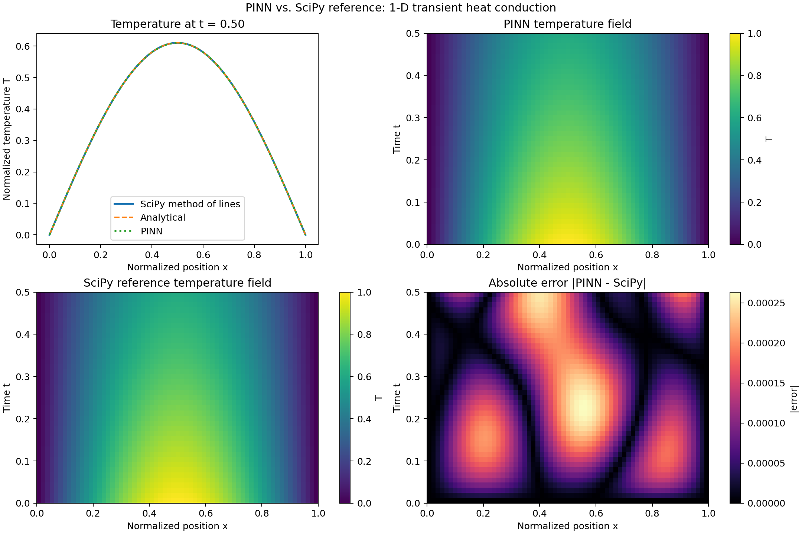

# Physics-Informed Heat-Diffusion Benchmark

A reproducible physics-informed neural network (PINN) for transient heat
conduction in a one-dimensional slab, benchmarked against an independent SciPy
method-of-lines solver. The PINN learns from the governing equation rather
than from reference-solver training data.

## Physical problem

The normalized temperature \(T(x,t)\) satisfies

\[
\frac{\partial T}{\partial t}
= \alpha \frac{\partial^2 T}{\partial x^2},
\qquad 0 < x < 1,\quad 0 < t \leq 0.5,
\]

with fixed-temperature boundaries \(T(0,t)=T(1,t)=0\), initial condition
\(T(x,0)=\sin(\pi x)\), and diffusivity \(\alpha=0.1\). The spatial coordinate
is normalized by slab thickness; temperature is normalized by the initial
temperature scale, and time and diffusivity use the corresponding consistent
normalized units.

The exact solution is \(T(x,t)=\exp(-\alpha\pi^2t)\sin(\pi x)\). It provides an
independent check on the SciPy reference solver, not training targets for the
PINN. The reference solver discretizes space with second-order central
differences and advances the resulting ODE system with SciPy's adaptive DOP853
integrator.

## PINN

A fully connected `tanh` network takes position and time and predicts
temperature. Its trial solution is

\[
T_\theta(x,t)=\sin(\pi x)+t\,x(1-x)N_\theta(x,t),
\]

which enforces both initial and boundary conditions exactly. Training
minimizes the mean-squared strong-form residual
\(T_t-\alpha T_{xx}\) over uniformly sampled interior collocation points; no
reference-solver or analytical-solution values enter training. Random seeds
are fixed for reproducible initialization and sampling.

## Run

Python 3.10 or later is required.

```powershell
python -m pip install -e ".[test]"
```

This installs the core dependencies declared in `pyproject.toml` together
with the optional test dependency.

Train, compare, and write the figure:

```powershell
python -m thermal_pinn
```

The command prints the PINN-vs-SciPy RMSE and maximum absolute error, the
SciPy-vs-analytical RMSE, and training residual diagnostics. It writes
`reports/thermal_pinn_vs_scipy.png` and exits with an error if PINN RMSE exceeds
0.03. Adjust runtime or output with `--steps`, `--collocation-points`,
`--spatial-points`, `--seed`, `--max-rmse`, and `--plot`. For example:

```powershell
python -m thermal_pinn --steps 2500 --collocation-points 512
```

Run the tests with:

```powershell
python -m pytest
```

## Benchmark visualization



Default run (`seed=42`, 2,500 Adam steps, 512 collocation points, 65 spatial
points):

| Metric | Result |
| --- | ---: |
| PINN RMSE vs. SciPy | 1.16e-4 |
| PINN maximum absolute error vs. SciPy | 2.63e-4 |
| SciPy RMSE vs. analytical solution | 2.80e-5 |
| PDE-residual RMSE, initial → final sampled batch | 6.79e-1 → 1.75e-3 |

## Scope and limitations

This is a controlled forward-simulation benchmark, not a material-property
estimator or a model calibrated against experimental data. The reference
solution has spatial-discretization error; it is separately checked against
the exact single-mode solution. The PINN's convergence and error depend on
architecture, collocation sampling, optimization, and time horizon. The
reported comparison measures this setup only and should not be interpreted as
evidence that a PINN generally outperforms a conventional numerical solver.
